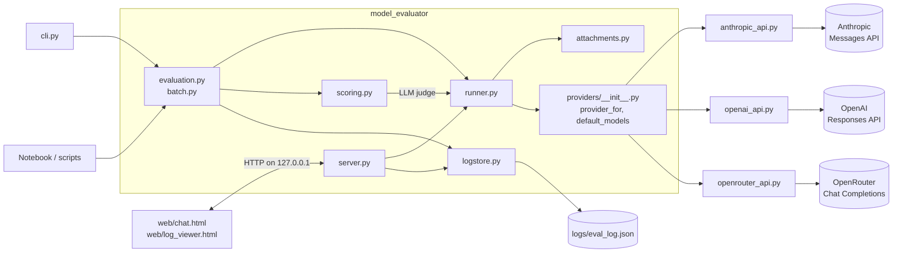

# Model Evaluator

[](https://github.com/ranveer-singh-10/APIModelEvaluatorTool/actions/workflows/ci.yml)

[](LICENSE)

**Which LLM gives the best answers for the money?** Model Evaluator sends the same prompts to models from
Anthropic, OpenAI and open-weight providers (through OpenRouter), scores every answer and works out what each
correct answer cost.

- **One interface, three APIs.** Anthropic Messages, OpenAI Responses and OpenRouter Chat Completions sit behind the
  same `chat()` / `usage_summary()` adapter, so 19 models can be compared side by side.
- **Accurate cost accounting.** Token counts are normalised across providers, including prompt-cache reads and
  writes, long-context price tiers and reasoning tokens. OpenRouter's billed cost is checked against the estimate.
- **Automated grading.** An LLM judge returns a 1–5 score through a JSON schema. Exact-match and contains scorers
  are also available, and the grader's own cost is kept separate.
- **Batch runs.** A dataset of cases runs against many models in parallel. The summary gives each model's
  average score, pass rate and **cost per pass**.
- **Local web UI.** A multi-model chat page (with image, PDF and text attachments) and a log viewer that has charts,
  filters, CSV export and manual grading that flags disagreements with the judge.

> Every command that runs a model makes real, billed API calls. The cost of each call is shown next to its result.

## Quickstart

```bash
git clone https://github.com/ranveer-singh-10/APIModelEvaluatorTool.git
cd APIModelEvaluatorTool
python -m venv .venv
source .venv/bin/activate        # Windows: .venv\Scripts\activate
pip install -e ".[dev]"
cp .env.example .env             # then add your API keys
```

`.env` needs `ANTHROPIC_API_KEY` and `OPENAI_API_KEY`. `OPENROUTER_API_KEY` is optional: without it, the
open-weight models are left out of default runs.

## Usage

### Command line

```bash
model-eval models                                   # list the priced models
model-eval evaluate claude-haiku-5-5 "What is quantum computing? Answer in one sentence"
model-eval compare "What is the capital of Australia?" --expected Canberra --providers anthropic openai
model-eval batch datasets/example.json --models claude-haiku-5-5 gpt-6-luna --log
model-eval chat                                     # multi-model chat page
model-eval logs                                     # log viewer
```

`python -m model_evaluator ...` does the same. Run `model-eval <command> --help` to see every option.

`compare` output looks like this (illustrative numbers):

```
Model             | Provider  | Time (s) | Input | Output | Total | Cost ($) | Score | Response
------------------+-----------+----------+-------+--------+-------+----------+-------+---------
claude-haiku-5-5  | anthropic |     0.84 |    21 |      5 |    26 | 0.000005 |   5/5 | Canberra
gpt-6-luna        | openai    |     0.92 |    20 |      4 |    24 | 0.000004 |   5/5 | Canberra
```

### Python

```python
from model_evaluator import evaluate, evaluate_all_models, evaluate_batch, chat_ui, view_logs

evaluate("claude-haiku-5-5", "What is quantum computing? Answer in one sentence")

evaluate_all_models(
    "What is the capital of Australia? Answer with just the city name.",
    expected="Canberra",
    log=True,
)

result = evaluate_batch("datasets/hard.json", models=["claude-sonnet-5-5", "gpt-6.1-sol"], log=True)
result["summary"]  # one row per model: avg_score, pass_rate, total_cost, cost_per_pass, ...
```

You can use each provider on its own too: `from model_evaluator.providers import anthropic_api` and call
`anthropic_api.chat(messages, ...)`. More examples are in [`examples/`](examples) and
[`notebook/eval_testing.ipynb`](notebook/eval_testing.ipynb).

## Scoring

Every score is on one 1–5 scale, and **4 or more is a pass**. Scoring is on whenever an expected answer or a
rubric is given.

| Scorer                | Needs                  | How it scores                                                                                   |
|-----------------------|------------------------|-------------------------------------------------------------------------------------------------|
| `llm_judge` (default) | `expected` or `rubric` | A grader model (`claude-sonnet-5-5` by default) returns `{reasoning, score}` through a JSON schema |
| `exact`               | `expected`             | 5 if the normalised response equals the expected answer, otherwise 1                            |
| `contains`            | `expected`             | 5 if the normalised response contains the expected answer, otherwise 1                          |

Datasets are JSON lists or JSONL files of `{"id"?, "prompt", "expected"?, "rubric"?}`. Two are included:
[`datasets/example.json`](datasets/example.json) (11 easy-to-moderate cases) and
[`datasets/hard.json`](datasets/hard.json) (15 harder ones, each exact answer checked by code).

## Architecture



```
src/model_evaluator/
├── providers/           One module per API, all with the same interface
│   ├── __init__.py      Provider registry: provider_for(), default_models()
│   ├── anthropic_api.py
│   ├── openai_api.py
│   └── openrouter_api.py
├── runner.py            One model call -> a result dict (response, tokens, cost, timing, error)
├── scoring.py           LLM judge, exact and contains scorers
├── evaluation.py        evaluate() and evaluate_all_models()
├── batch.py             Datasets, parallel batch runs and the per-model summary
├── attachments.py       Validation and per-provider conversion of images, PDFs and text files
├── logstore.py          The JSON run log, with locking and manual grading
├── server.py            Local HTTP server behind the chat page and log viewer
├── cli.py               The model-eval command
└── web/                 Self-contained HTML pages with no dependencies
tests/                   pytest suite, with every API call faked
examples/                Small scripts that use each provider directly
datasets/                Evaluation cases
```

## Design decisions

- **The adapter pattern keeps the evaluation code provider-neutral.** Each provider module exposes `MODEL_PRICING`,
  `chat()`, `text_from_response()`, `stop_reason()`, `usage_summary()` and `user_content()`. Adding a provider
  means writing one module and registering it. Nothing else changes.
- **Costs are normalised, not just added up.** OpenAI's `input_tokens` already includes cached tokens, while
  Anthropic's doesn't. Each adapter reports uncached input separately, prices cache writes by their TTL and switches
  to long-context prices above each model's threshold. For OpenRouter, the cost it actually billed takes priority,
  with the estimate kept for comparison.
- **The judge is constrained and isolated.** The grader's score must match a `1-5` enum in a JSON schema, so its
  output can always be parsed. The prompt, expected answer and response each sit in their own XML tag, so a response
  can't pose as the expected answer. A failed model call counts as an error, not a wrong answer, and the judge's
  cost never goes into the model's cost.
- **Concurrency is a simple fit for I/O-bound work.** Batch runs and chat turns use a `ThreadPoolExecutor`, since
  the time is spent waiting on the network. The log is read, changed and written under a lock, so parallel runs
  can't lose each other's entries. The chat page receives NDJSON, so each model's answer appears as soon as it's
  ready.
- **The local server is locked down.** It binds to `127.0.0.1`, serves only an allowlist of routes (never the
  project folder or `.env`), and only accepts `POST` requests whose `Origin` and `Host` are its own, which blocks
  cross-site requests and DNS rebinding. On Windows it binds its port exclusively, so another process can't share
  it.
- **Manual grades use optimistic concurrency.** A grade names the log entry by index *and* timestamp. If the log has
  changed, the server answers `409` and the page reloads, instead of grading the wrong result. The judge's original
  score is kept, so clearing a manual grade restores it.
- **The tests run without API keys.** Clients are created on first use, and every model call in the tests is faked,
  so CI runs the full suite (including a real HTTP server) without spending anything.

## Development

```bash
pytest                 # 111 tests, no network calls
ruff check .           # lint
ruff format .          # format
```

CI runs ruff, plus pytest on Ubuntu and Windows with Python 3.11 and 3.13. Notebooks go through
[`nbstripout`](https://github.com/kynan/nbstripout) on commit: run
`nbstripout --install --attributes .gitattributes` once after cloning.

**To add a model**, add its prices (USD per million tokens) to the provider's `MODEL_PRICING`. **To add a provider**,
write a module in `src/model_evaluator/providers/` with the same interface and register it in `PROVIDERS`.

## License

[MIT](LICENSE)
